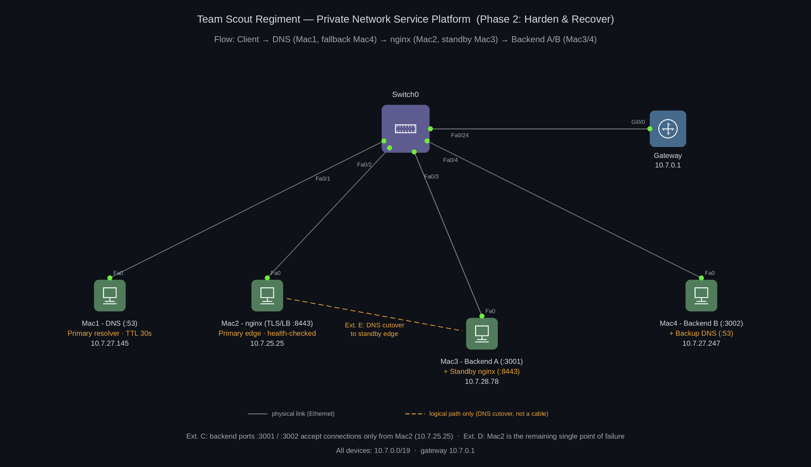

# Private Network Service Platform — Team Scout Regiment

Computer Networks course project on four local Macs. The finalized submission
branch contains corrected code/configuration, both reports, architecture PDF and
original main-branch screenshots alongside reviewed new terminal evidence.

Start with **[SUBMISSION.md](SUBMISSION.md)** for package contents, verified results
and the remaining disclosed evidence limits. Browse the **[screenshot gallery](docs/submission-evidence.html)**
offline or use the [historical image index](evidence/phase2/INDEX.md) on GitHub.
The [11-step runbook](docs/phase2-demo-runbook.md) covers evaluation; [member commands](docs/team-commands.md)
are reference procedures for future setup. Follow-up collection resumed to close the remaining evidence items.

| Member | Mac | Current IP | Services |
|---|---|---|---|
| Rashmi Anand (2401010374) | 1 | 10.7.27.145 | primary DNS, client |
| Samiksha Jangid (2401010410) | 2 | 10.7.25.25 | primary nginx/TLS/load balancer, coordinator |
| Shubhaang Kataruka (2401010450) | 3 | 10.7.28.78 | Backend A :3001, standby nginx :8443 |
| Ankit Raj Singh (2401010075) | 4 | 10.7.27.247 | Backend B :3002, backup DNS :53 |

`app.team1.test` and `api.team1.test` point to Mac 2. `ttl.team1.test` is the
separate TTL experiment record. Both resolvers must serve the same records;
normal TTL is 30 seconds. The service URL is **https://app.team1.test:8443**.
8080/8443 are explicitly permitted by the evaluation document. No cloud service
hosts this project.

## Request path

Client → private DNS (UDP/TCP 53) → TCP 8443 → TLS at nginx → HTTP to
Backend A :3001 or Backend B :3002 → encrypted response to client.
`X-Backend` identifies the backend; `X-Edge` identifies primary/standby.



The topology image is a schematic of the roles, not a claim that the laptops
use physical switch cables. See [architecture](docs/architecture.md) and
[inventory](docs/network-inventory.md) for protocol paths and historical addresses.

## Backend behavior

| Route | Response | Cache behavior |
|---|---|---|
| GET / | backend running message and A/B label | ordinary response |
| GET /api/status | status=ok, backend=A/B; X-Backend | no-store, suitable for balancing/failover |
| GET /api/cache-demo | identical representation on A and B | max-age=60, shared ETag, conditional 304 |

The cache-demo body is intentionally identical on both backends. Its validator
therefore remains valid when the next conditional request reaches the other
backend. Backend identity remains in `X-Backend`. TLS verification stays enabled;
test scripts use system curl and never use `-k`.

## Local source checks (no LAN required)

```bash
python3 -m venv .venv
source .venv/bin/activate
python -m pip install -r backend-a/requirements.txt
python -m unittest discover -s tests -v
python scripts/submission-check.py --source-only
```

## Live checks (after applying configs on the correct Macs)

```bash
scripts/test-backup-dns.sh both-up
scripts/test-https.sh
scripts/test-load-balancing.sh
scripts/test-ha-failover.sh balanced
```

All assertion scripts return nonzero on a mismatch. `test-dns-ttl.sh` checks the
configured TTL only; use [TTL experiments](docs/ttl-experiments.md) for actual
expiry and manual-flush proof. Each mutation helper checks which Mac it is on,
keeps local backups, and documents rollback.

## Submission package

| Required item | Location / status |
|---|---|
| Architecture, topology, IP/service table, protocol flow | [architecture.md](docs/architecture.md), [printable PDF](docs/architecture-document.pdf), [inventory](docs/network-inventory.md) |
| DNS, nginx P1/P2, standby, TLS notes, firewall | [dns](dns/), [edge](edge/), [firewall](firewall/) |
| Both backend sources and launch instructions | [A](backend-a/), [B](backend-b/) |
| Historical screenshots and current evidence | [evidence index](evidence/README.md), [Phase 2 index](evidence/phase2/INDEX.md) |
| Phase 1 report | [phase1-report.md](reports/phase1-report.md), historical submitted baseline |
| Phase 2 changes, results, troubleshooting and six learning paragraphs | [phase2-report.md](reports/phase2-report.md) |
| Final demonstration and viva preparation | [11-step runbook](docs/phase2-demo-runbook.md), [viva notes](docs/viva-notes.md) |
| Acceptance ledger | [verification-status.json](reports/verification-status.json) — reviewed results and disclosed limits |

Run `python3 scripts/submission-check.py` for the strict evidence gate. It must
remain failing while mandatory evidence is pending. Passing a file-existence
gate alone does not grade packet contents or replace live viva.

## Phase 2 acceptance

- A: backup listener; identical records; two clients list both resolvers; fresh
  by-name HTTPS succeeds with primary DNS stopped; backup receives the query.
- B: real client cache keeps OLD until expiry then gets NEW; a separate manual
  flush changes OLD to NEW before natural expiry.
- C: Mac 2 allowed and Mac 1 denied on both backend ports; HTTPS still works;
  project rules are rolled back without disabling other PF owners.
- D: A/B baseline; A stopped gives only B with 200; restarted A rejoins.
- E: valid standby HTTPS; synchronized DNS cutover; cached-old and fresh-new
  behavior; convergence and restoration on both resolvers.
- F: rehearse diagnosis now; faculty's actual injected challenge and personal
  viva remain live evaluation requirements.

The primary edge remains a single point of failure until an operator performs
the DNS cutover. Passive backend checks are supported by open-source nginx;
paid active checks and automatic edge failover are not required by this project.
