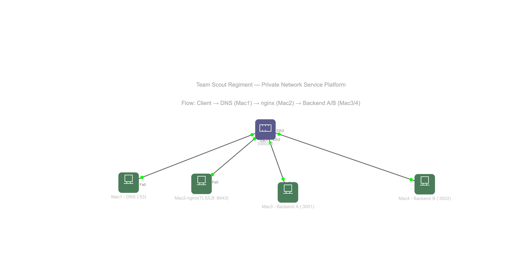
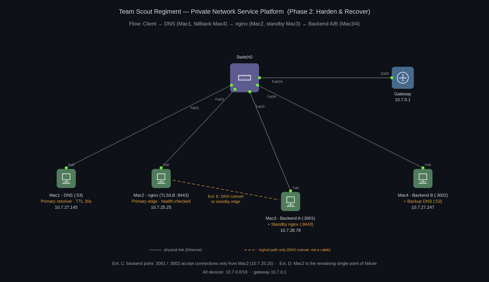

# Architecture Document — Private Network Service Platform (Team Scout Regiment)

Four macOS laptops on one private LAN (`10.7.0.0/19`, gateway `10.7.0.1`, interface
`en0`), serving a private domain over HTTPS through a reverse proxy and load balancer.
This document has **two divisions** — Phase 1 (build) and Phase 2 (harden) — each with a
topology diagram, a machine-role / IP-service table, and a request-flow diagram showing
each protocol layer.

> **Printable version:** [architecture-document.html](architecture-document.html)
> (open in a browser → Print → Save as PDF) and [architecture-document.pdf](architecture-document.pdf).

> **Note on addresses.** The LAN IPs differ between Phase 1 and Phase 2 because DHCP issued
> new leases in each session. The **domain names and MAC addresses did not change** — the
> whole point of running DNS. Both sets are in [network-inventory.md](network-inventory.md).

---

# DIVISION 1 — PHASE 1 · Build & Observe

## 1.1 Topology diagram



Text version of the same topology:

```
                    Private Wi-Fi / LAN (same subnet)
   ┌──────────────┬──────────────────┬──────────────┬──────────────┐
   │              │                  │              │              │
┌──┴───┐      ┌───┴────┐         ┌────┴───┐      ┌───┴────┐
│ Mac 1 │      │ Mac 2  │         │ Mac 3  │      │ Mac 4  │
│ DNS + │      │ Edge   │         │Backend │      │Backend │
│Client │      │ nginx  │         │  A     │      │  B +   │
│dnsmasq│      │ TLS/LB │         │ :3001  │      │Client  │
│  :53  │      │ :8443  │         │        │      │ :3002  │
└───────┘      └────────┘         └────────┘      └────────┘
 Rashmi        Samiksha          Shubhaang         Ankit
```

## 1.2 Machine roles & IP / service table (Phase 1)

| Machine | Member    | Role                      | Service address (Phase 1) | Cloud equivalent          |
|---------|-----------|---------------------------|---------------------------|---------------------------|
| Mac 1   | Rashmi    | Private DNS + Test Client | `10.7.17.21:53` (UDP/TCP) | Managed DNS (Route 53)    |
| Mac 2   | Samiksha  | Edge / Reverse Proxy + LB | `10.7.7.9:8443` (HTTPS)    | Cloud load balancer / CDN |
| Mac 3   | Shubhaang | Backend Server A          | `10.7.21.15:3001`         | App server instance A     |
| Mac 4   | Ankit     | Backend Server B + Client | `10.7.23.47:3002`         | App server instance B     |

**DNS records:** `app.team1.test` and `api.team1.test` → `10.7.7.9` (Mac 2).

## 1.3 Request-flow diagram — each protocol layer

```
Client (Mac 1 / Mac 4)
   │ 1. DNS QUERY    ── UDP :53  ──►  Mac 1 (dnsmasq)   "app.team1.test = ?"  → 10.7.7.9
   │ 2. TCP HANDSHAKE ── TCP :8443 ─►  Mac 2   SYN → SYN-ACK → ACK
   │ 3. TLS HANDSHAKE ──►  Mac 2   ClientHello → ServerHello → Certificate → Finished
   │ 4. HTTPS REQUEST ──►  Mac 2   GET /api/status                 (payload now encrypted)
   ▼
Mac 2  nginx reverse proxy + round-robin load balancer
   ├── 5. HTTP ── TCP :3001 ──► Mac 3  Backend A   (X-Backend: A)
   └── 5. HTTP ── TCP :3002 ──► Mac 4  Backend B   (X-Backend: B)
   │ 6. HTTP RESPONSE (JSON + X-Backend + Cache-Control), over the encrypted TLS channel
   ▼
Client receives the response
```

| Step | Protocol          | OSI layer           | Port / addressing                 |
|------|-------------------|---------------------|-----------------------------------|
| 1    | DNS               | Application         | 53/UDP                            |
| 2    | TCP               | Transport           | 8443/TCP (SYN/SYN-ACK/ACK)        |
| 3    | TLS               | Session / Transport | 8443/TCP                          |
| 4/6  | HTTP / HTTPS      | Application         | 8443/TCP                          |
| 5    | HTTP (to backend) | Application         | 3001 / 3002 TCP                   |
| —    | IP / Ethernet     | Network / Link      | IP + MAC addresses (no ports)     |

**Key points**
- **DNS is a directory, not a connection** — it maps the name to Mac 2's IP; the TCP/TLS
  connection is a separate step.
- The **client never knows the backend IPs**; it only talks to the edge (Mac 2).
- After the TLS handshake the HTTP payload is **encrypted** — Wireshark shows
  `Application Data`; use `curl -v` for the cleartext view.

> Ports note: if a Mac cannot bind 80/443, use 8080/8443 instead (no marks lost).

---

# DIVISION 2 — PHASE 2 · Harden, Recover & Troubleshoot

Phase 2 extends the **same** network (nothing rebuilt). Five additions for resilience,
security and diagnosability. Addresses below are the Phase 2 (DHCP-reassigned) IPs.

## 2.1 Topology diagram (hardened)



Text version of the hardened topology:

```
                         ┌─────────────────── PRIVATE LAN (10.7.0.0/19) ───────────────────┐
   ┌──────────────┐  DNS primary :53    ┌──────────────┐                                   │
   │   CLIENT     │────────────────────►│ Mac 1  DNS   │ 10.7.27.145  ◄─ Ext B: 30s TTL +  │
   │ resolver:    │                     │ (dnsmasq)    │                 ttl.team1.test     │
   │ 27.145 +     │  DNS backup :53     └──────────────┘                                   │
   │ 27.247       │────────────────────►┌──────────────┐ 10.7.27.247  ◄─ Ext A: backup     │
   └──────┬───────┘                     │ Mac 4  DNS   │                 (same records)     │
          │  HTTPS 8443 (by name)       └──────────────┘                                   │
          ▼                                                                                 │
   ┌──────────────┐  Ext E: DNS cutover repoints name ──► ┌──────────────┐                  │
   │ Mac 2  EDGE  │ 10.7.25.25  (X-Edge: primary-mac2)     │ Mac 3 STANDBY│ 10.7.28.78       │
   │ nginx + TLS  │  Ext D: passive health-check failover  │ nginx (same  │ X-Edge:          │
   │              │  (max_fails / proxy_next_upstream)     │ cert/upstream)│ standby-mac3     │
   └──────┬───────┘                                        └──────────────┘                  │
          │ HTTP 3001/3002 ── Ext C: pf firewall — ONLY the edge (10.7.25.25) may connect ── │
          ├──────► Mac 3  Backend A :3001   (all other clients blocked)                      │
          └──────► Mac 4  Backend B :3002   (all other clients blocked)                      │
                         └──────────────────────────────────────────────────────────────────┘
```

## 2.2 Machine roles & IP / service table (Phase 2)

| Machine | Member    | Phase 2 role(s)                      | Service address (Phase 2)          | Phase 1 address |
|---------|-----------|--------------------------------------|------------------------------------|-----------------|
| Mac 1   | Rashmi    | Primary DNS (dnsmasq) + client       | `10.7.27.145:53`                   | `10.7.17.21`    |
| Mac 2   | Samiksha  | Primary edge — TLS + LB + HA failover| `10.7.25.25:8443`                  | `10.7.7.9`      |
| Mac 3   | Shubhaang | Backend A **+ standby edge**         | `10.7.28.78:3001`, standby `:8443` | `10.7.21.15`    |
| Mac 4   | Ankit     | Backend B **+ backup DNS**           | `10.7.27.247:3002`, DNS `:53`      | `10.7.23.47`    |

**DNS records (Phase 2):** `app` / `api` / `ttl.team1.test` → `10.7.25.25` (Mac 2), TTL 30 s.
During Ext E the name is temporarily repointed to `10.7.28.78` (Mac 3 standby).

## 2.3 Request-flow diagram — resilience paths

The same DNS → TCP → TLS → HTTP flow as Phase 1, now with an alternate path at every layer:

```
 DNS    client resolves via  Mac 1 primary  ──(if down)──►  Mac 4 backup        [Ext A]
 EDGE   HTTPS by name to     Mac 2 primary  ──(DNS cutover)─► Mac 3 standby      [Ext E]
 BACK   edge balances A / B  ──(A down)──►  all traffic to B, HTTP 200 (no 502)  [Ext D]
 GUARD  backends accept connections ONLY from the edge 10.7.25.25 (pf firewall)  [Ext C]
```

| Ext | Addition | Effect |
|-----|----------|--------|
| A | Backup DNS on Mac 4 | Name resolution survives the primary DNS going down |
| B | 30 s TTL + record change | Controlled, observable cutover; cache vs authoritative |
| C | pf firewall on Mac 3 / Mac 4 | Backends reachable **only** via the edge (defence in depth) |
| D | nginx passive health checks | Service survives a backend failure; no `502` to the client |
| E | Standby edge on Mac 3 + DNS cutover | The entry point can be migrated with no new hardware |

### Failure vs recovery — which layer each extension protects

| If this fails… | …this is what saves it | Extension |
|----------------|------------------------|-----------|
| Primary DNS (Mac 1) down | Backup DNS (Mac 4) answers the same names | A |
| A backend (Mac 3 / 4) down | HA failover routes to the healthy backend | D |
| The edge (Mac 2) down | DNS cutover to the standby edge (Mac 3) | E (manual) |
| A client bypasses the edge | pf firewall blocks direct backend access | C |

**Remaining single point of failure:** the edge nginx on Mac 2. Eliminating it fully needs a
second always-on edge plus a floating/virtual IP or automatic DNS failover — Extension E is
the manual version of this.
