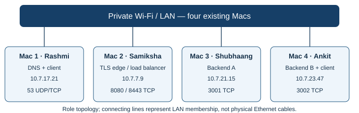
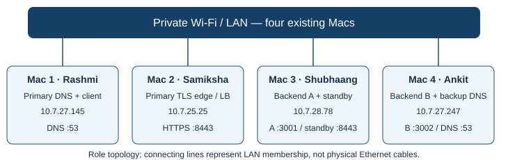

# Architecture — Private Network Service Platform

Four existing macOS laptops on a private LAN. Service names are app.team1.test
and api.team1.test; TLS ends at nginx on 8443 and the internal backend leg is HTTP.
The app stays simple; the network path, evidence and failure diagnosis are the project.

## Phase 1 — submitted historical baseline



| Mac | Role | Historical address | Cloud analogy |
|---|---|---|---|
|1 Rashmi|DNS + client|10.7.17.21:53|managed DNS|
|2 Samiksha|nginx/TLS/load balancer|10.7.7.9:8443|application load balancer|
|3 Shubhaang|Backend A|10.7.21.15:3001|app instanceA|
|4 Ankit|Backend B + client|10.7.23.47:3002|app instanceB|

An earlier pair of dig screenshots used DNS lease 10.7.21.14. Later Phase 1 client/
packet proof uses 10.7.17.21. Those are historical exhibits, not current addressing.

```text
1. Client -> Mac 1 DNS, UDP53: name -> Mac 2 address
2. Client ephemeral TCP port -> Mac 2:8443: SYN / SYN-ACK / ACK
3. Client <-> Mac 2: TLS handshake and certificate validation
4. Client -> Mac 2: encrypted HTTP request by hostname
5. Mac 2 -> A:3001 OR B:3002: HTTP request on the private LAN
6. Backend -> Mac 2: JSON + X-Backend + relevant cache headers
7. Mac 2 -> client: HTTP response inside encrypted TLS records
```

DNS/HTTP are application protocols; TCP/UDP transport; IP network; Ethernet/Wi-Fi
link. TLS runs over TCP below HTTP (session/transport in the course's simplified
mapping). DNS is a directory lookup, not the TCP or HTTPS connection itself.

## Phase 2 — same roles, added resilience and diagnosis



| Mac | Current role | Current address |
|---|---|---|
|1 Rashmi|primary DNS + client|10.7.27.145:53|
|2 Samiksha|primary TLS edge/LB|10.7.25.25:8443|
|3 Shubhaang|Backend A + standbyTLS edge|10.7.28.78:3001 and :8443|
|4 Ankit|Backend B + backup DNS|10.7.27.247:3002 and :53|

```text
DNS: client -> primary Mac 1; backup Mac 4 provides another resolver
EDGE: client -> primary Mac 2; controlled DNS change -> standby Mac 3
BACKEND: primary/standby edge -> A:3001 OR B:3002
FAILURE: A stopped -> successful responses through B; A returns -> A/B
ISOLATION C: only primary Mac 2 -> backend ports, ordinary clients denied
C ROLLBACK: restore owned rules/token after the isolation demonstration
MIGRATION E: standby becomes an edge during synchronized DNS cutover
DIAGNOSIS F: DNS -> TCP -> TLS -> edge HTTP -> permitted backend checks
```

A backup resolver must have identical data; a cached answer alone is not proof of
using it. Real timed client-cache experiments distinguish TTL expiry from manual
flush. See [TTL procedure](ttl-experiments.md). The primary and standby use the
same routing, timeout and TLS policy, and identify themselves with X-Edge.

**Firewall/migration policy:** C demonstrates strict Mac 2-only access then rolls
back as required. For optional combined hardened migration, explicitly permit
both designated edge sources during the cached-old/new transition and restore
the prior policy afterwards. Ordinary client access stays denied under that policy.
The strict C rules cannot silently coexist with a Mac 3 standby contacting Backend B.

**Remaining SPOF:** the primary nginx entry point needs operator DNS cutover on
failure. Full automatic edge redundancy would need an always-on second edge and
a floatingVIP/automatic DNS mechanism. The shared LAN/router is another dependency.
No additional physical hardware or cloud deployment is required.

See [inventory](network-inventory.md), [final runbook](phase2-demo-runbook.md),
[viva explanations](viva-notes.md), and [verification ledger](../reports/verification-status.json).
The [printable PDF](architecture-document.pdf) is generated from
[the HTML source](architecture-document.html), with wrapped flows on four pages.
