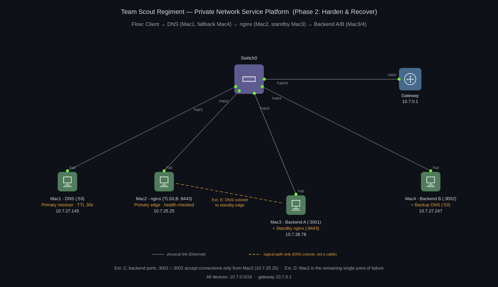

# Team Scout Regiment — Private Network Service Platform
## Phase 2 Final Report — Harden, Recover, and Troubleshoot

**Prepared:** 20 November 2026
**Document status:** Draft with explicitly labeled verified / user-reported / pending outcomes. Replace evidence placeholders after attaching the corresponding real screenshots (naming scheme A1–A4, B1–B4, C1–C5, D1–D3, E1–E4 — see [../evidence/phase2/EVIDENCE-CHECKLIST.md](../evidence/phase2/EVIDENCE-CHECKLIST.md)). Do not represent a pending challenge as completed.

### 1. Team and system inventory

| Machine | Member | Role | Observed LAN address / service |
|---|---|---|---|
| Mac 1 | Rashmi Anand | Primary dnsmasq DNS | `10.7.27.145:53/udp,tcp` |
| Mac 2 | Samiksha Jangid | Nginx HTTPS reverse proxy/load balancer | `10.7.25.25:8443` |
| Mac 3 | Shubhaang Kataruka | Flask Backend A and standby nginx | `10.7.28.78:3001`, standby `:8443` |
| Mac 4 | Ankit Raj Singh | Flask Backend B and secondary DNS | `10.7.27.247:3002`, DNS `:53` |

The `10.7.*` addresses were observed on 20 November; they are DHCP assignments and must be rechecked before evaluation. Phase 1 used a different lease set — both are tabulated in [../docs/network-inventory.md](../docs/network-inventory.md). The domain names and MAC addresses did not change between phases, which is precisely why DNS is used.

**Normal request flow:** client → private DNS (Mac 1 / backup Mac 4) resolves `app.team1.test` → TLS 1.2/1.3 connection by hostname to Mac 2 nginx on `8443` → plaintext HTTP within the LAN to Backend A (`3001`) or Backend B (`3002`) → response containing `X-Backend` identifier. A separate `api.team1.test` record is provided. The client validates the nginx server certificate without bypass flags.

**Phase 2 hardened topology:**

Backup DNS (Mac 4), standby edge (Mac 3), backend firewall (Ext C), HA failover (Ext D), and
the dashed Ext E DNS cutover — labelled with the Phase 2 addresses used in this session
(see [../docs/network-inventory.md](../docs/network-inventory.md)).

### 2. Phase 1 baseline retained

- Two Flask REST services expose `/api/status` and `/api/cache-demo` and include their backend labels.
- The nginx edge balances successful requests across A and B; full HTTPS requests received HTTP `200` on 20 November.
- DNS, Wireshark captures, TLS verification, caching / conditional 304 and failure snapshots from the Phase 1 repository remain available. DHCP addresses and timestamps in historical exhibits must be distinguished from the current demonstration.

### 2.1 What changed from Phase 1

The network was **not** rebuilt — the following was added on top of the Phase 1 system:

| Area | Phase 1 | Phase 2 |
|---|---|---|
| DNS | single resolver (Mac 1) | + backup resolver on Mac 4; 30 s TTL; `ttl.team1.test` record (Ext A, B) |
| Edge | round-robin, no failover | passive health checks `max_fails`/`proxy_next_upstream`; standby edge on Mac 3 (Ext D, E) |
| Backends | open on the LAN | isolated by `pf` — only the edge (`10.7.25.25`) may reach `:3001`/`:3002` (Ext C) |
| Resilience | single points everywhere | survives: primary DNS down, one backend down, edge migrated |
| LAN IPs | `10.7.17.21 / 10.7.7.9 / 10.7.21.15 / 10.7.23.47` | `10.7.27.145 / 10.7.25.25 / 10.7.28.78 / 10.7.27.247` (DHCP release; names unchanged) |

New files added in Phase 2: `dns/dnsmasq-phase2.conf.example`, `dns/backup-dnsmasq.conf.example`,
`edge/nginx-phase2.conf.example`, `edge/standby-nginx.conf.example`, `firewall/*`, and the
`scripts/test-backup-dns.sh` / `test-dns-ttl.sh` / `test-ha-failover.sh` / `test-backend-isolation.sh` scripts.

### 3. Mandatory Phase 2 extension outcomes

| Extension | Work and observable results | Evidence status |
|---|---|---|
| **A — Backup DNS** | Mac 1 and Mac 4 both returned `10.7.25.25` for `app.team1.test`. Mac 4 logs record DNS queries from Mac 2 and Mac 3. Mac 1 service-stop and restart logs exist; client HTTPS requests succeeded after cache flush. | **Operational verified; synchronize screenshot timeline to establish service outage and client lookup overlap.** Attach A1–A4 → [../evidence/phase2/backup-dns/](../evidence/phase2/backup-dns/) |
| **B — TTL and record change** | Primary dnsmasq served a 30-second TTL. While authoritative record `ttl.team1.test` changed from `10.7.25.25` to `10.7.28.78`, Mac 3 retained the older cached answer. After ~35 seconds, client lookup returned the updated IP. | **TTL/caching/expiry verified; manual-flush proof pending** (before/after must show different IPs). Attach B1–B4 → [../evidence/phase2/ttl/](../evidence/phase2/ttl/) |
| **C — Backend service isolation** | PF project anchors on Mac 3 and Mac 4 loaded rules permitting only Mac 2 to access ports 3001 and 3002. Mac 1's direct connections to both ports timed out (`curl (28) … Timeout`), while Mac 2 got `HTTP 200` from both. Clearing rules and releasing PF enable references restored access from Mac 1. | **Verified PASS from supplied Mac logs.** Attach C1–C5 → [../evidence/phase2/isolation/](../evidence/phase2/isolation/) |
| **D — Backend failover** | With Backend A down, Mac 2 recorded ten successful HTTP 200 requests with `X-Backend: B`. After restarting A, both `X-Backend: A` and `B` returned. | **Verified PASS from supplied Mac 2 logs.** Attach D1–D3 → [../evidence/phase2/ha-failover/](../evidence/phase2/ha-failover/) |
| **E — Standby edge migration** | A separate nginx instance was configured on Mac 3 (`X-Edge: standby-mac3`); config syntax check passed, start returned without fatal error. Standby HTTPS returned `200` with `X-Backend: A`/`B`; DNS cutover repointed `app.team1.test` to `10.7.28.78`, then was restored to `10.7.25.25`. | **Reported PASS by team; attach E1–E4 to independently certify.** → [../evidence/phase2/edge-migration/](../evidence/phase2/edge-migration/) |
| **F — Faculty-injected troubleshooting** | Prepared to check in order DNS → TCP → TLS → application. Historical Phase 1 failure evidence includes wrong resolver, wrong destination address, one/both backends down and wrong port. | **Final live faculty-injected challenge cannot be certified before it is administered.** → [../evidence/phase2/troubleshooting/](../evidence/phase2/troubleshooting/) |

### 4. Protocol, reliability and security conclusions

**Extension A (backup DNS):** The resolver is an independent network service. When the primary DNS is unavailable, clients that actually use a working secondary resolver can still resolve the same hostname and connect to a healthy application. This differs from an application outage where DNS resolves but the destination service fails. DNS failover must be shown with the primary stopped at the same time the backup answers a client query.

**Extension B (DNS TTL):** A TTL expresses how long a caching resolver can consider a DNS answer fresh; it does not automatically force clients to connect to an updated address. In our test, a direct query to the DNS server immediately saw the changed address, while a client lookup temporarily kept the old cached record and refreshed after expiry. A manual cache-flush demonstration needs explicitly different before/after IP values to be counted.

**Extension C (service isolation):** PF filters evaluated inbound connections to backend service ports. Allowing Mac 2 while blocking other LAN clients prevents clients from bypassing the TLS-terminating edge. The test included one permitted source, one denied source, and rollback to original connectivity. This test configuration was temporary and should not be conflated with a persistent enforced policy.

**Extension D (backend failover):** Nginx continued serving application requests via healthy Backend B while A was unavailable. Recovery of A restored load balancing. Passive retry and temporary upstream suppression address a backend failure but not failure of the edge process on Mac 2 itself; the primary architecture still has this single point of failure.

**Extension E (edge migration):** A separately configured nginx instance on Mac 3 can act as a standby edge with the same hostname and valid TLS identity. A coordinated DNS record update can direct new lookups to that edge, but clients holding old cached answers may temporarily connect to the original edge until expiration. This is a controlled cutover, not autonomous edge failover; show both the DNS update and the new HTTPS destination. The certificate's **leaf private key** must remain outside GitHub.

**Extension F (diagnosis):** The failure layer matters: an incorrect DNS lookup differs from a TCP refusal/time-out, a TLS trust failure, or an application upstream `502`. We use a reproducible sequence and explain the evidence at each layer. The faculty's injected fault must be identified and resolved or isolated during the review; no result is invented ahead of that event.

### 5. Evaluation sequence — 11 steps

1. Show topology, four current IP addresses and active ports/services.
2. Show all Macs on LAN; verify required inter-Mac reachability (explain any ICMP restriction separately from successful DNS/TCP).
3. Client resolves `app.team1.test` to Mac 2 through the private resolver.
4. Trusted HTTPS request to `https://app.team1.test:8443` (never `curl -k`).
5. Repeated requests show both A and B in `X-Backend`.
6. Open Wireshark evidence: DNS query/answer, TCP SYN/SYN-ACK/ACK, TLS ClientHello/ServerHello.
7. Show cache-control headers and existing 304/cached response evidence.
8. Stop A; show all HTTP 200 via B; restore A and verify balancing.
9. Show backup DNS, TTL cached behaviour and standby-edge migration evidence.
10. Diagnose the live faculty-injected fault via DNS → TCP → TLS → HTTP.
11. Each member explains the full architecture and their responsibilities in viva.

